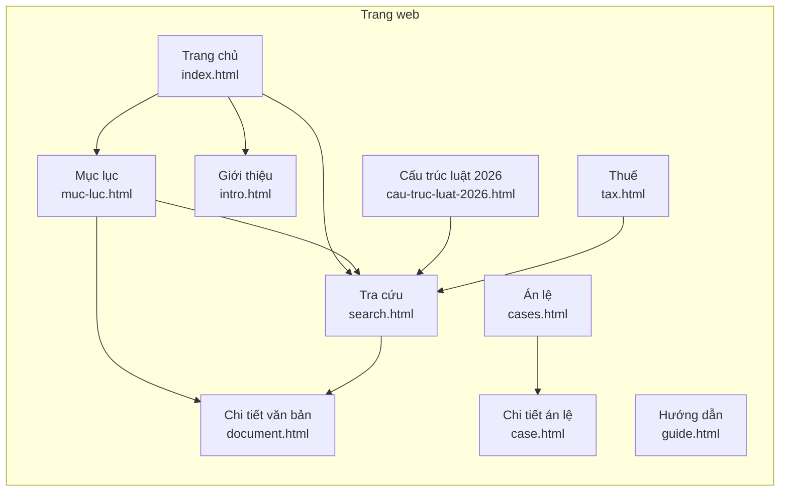
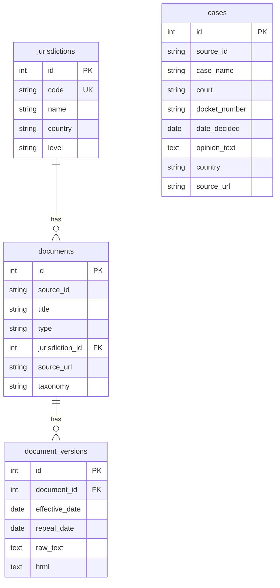
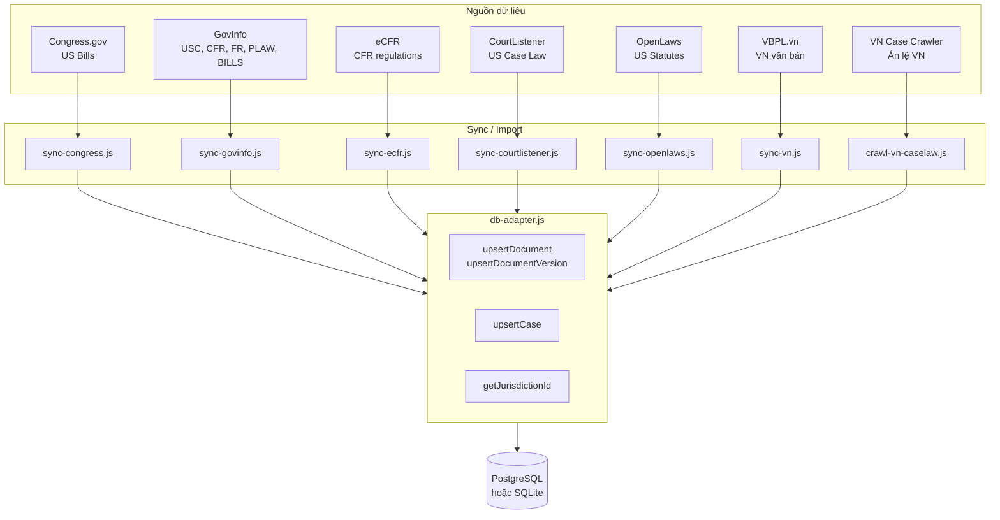
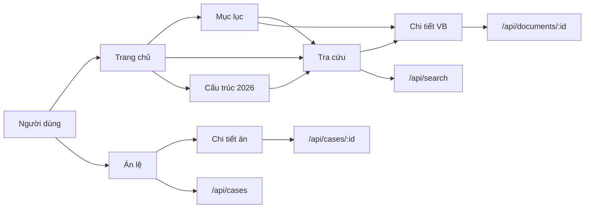

# Toàn thư luật pháp — Tài liệu toàn bộ hệ thống

Tài liệu mô tả mọi tính năng, kiến trúc, dữ liệu và vận hành của website **Toàn thư luật pháp** (US & Vietnam legal encyclopedia).

---

## 1. Tổng quan

| Mục | Mô tả |
|-----|--------|
| **Tên** | Toàn thư luật pháp |
| **Mục đích** | Bộ sách tham khảo trực tuyến về pháp luật của 13 quốc gia chính, mốc thời gian 2026 |
| **Đối tượng** | Sinh viên luật, luật sư, thẩm phán, doanh nghiệp, công dân |
| **Stack** | Node.js (Express), HTML/CSS/JS, SQLite hoặc PostgreSQL |
| **Repo** | https://github.com/NorvixAdamas/toanthuluat |

---

## 2. Sơ đồ kiến trúc tổng thể

```mermaid
flowchart TB
    subgraph Client[Trình duyệt]
        UI[HTML / CSS / JS]
    end

    subgraph Server[Express Server - server/index.js]
        Static[express.static - public/]
        API[/api/*]
        Middleware[CORS, compression, json]
    end

    subgraph API_Routes[API Routes - server/api/]
        Search[/api/search]
        Docs[/api/documents/:id]
        Cases[/api/cases]
        CaseId[/api/cases/:id]
        Juris[/api/jurisdictions]
        Health[/api/health]
    end

    subgraph Data[Lớp dữ liệu]
        Queries[queries.js]
        PG[(PostgreSQL)]
        SQLite[(SQLite)]
    end

    subgraph Jobs[Import / Sync - server/jobs/]
        DbAdapter[db-adapter.js]
        SyncAll[sync-all.js]
        ImportCLI[import-cli.js]
        Congress[sync-congress]
        GovInfo[sync-govinfo]
        Ecfr[sync-ecfr]
        CourtListener[sync-courtlistener]
        VN[sync-vn]
        VNCase[crawl-vn-caselaw]
    end

    UI --> Static
    UI --> API
    API --> API_Routes
    Search --> Queries
    Docs --> Queries
    Cases --> Queries
    CaseId --> Queries
    Juris --> Queries
    Queries --> PG
    Queries --> SQLite
    Jobs --> DbAdapter
    DbAdapter --> PG
    DbAdapter --> SQLite
```

---

## 3. Tính năng theo trang



### 3.1 Trang chủ (`/`, `index.html`)

- Hero: tiêu đề, mô tả, nút Mục lục / Giới thiệu / Tra cứu.
- **Cấu trúc toàn thư**: 4 thẻ (Phần I–IV) dẫn tới mục lục.
- **Dành cho ai?**: 4 nhóm (sinh viên luật, luật sư, thẩm phán, doanh nghiệp & công dân).
- Bắt đầu từ đâu: link Mục lục, Cấu trúc luật 2026, Hướng dẫn.

### 3.2 Mục lục (`/muc-luc.html`)

- **Phần I**: Giới thiệu & Cách dùng (intro, guide, cấu trúc 2026).
- **Phần II – Luật Hoa Kỳ**: danh sách theo loại (statute/regulation), theo chủ đề (từ `cau-truc-luat-2026.json`), link Thuế.
- **Phần III – Luật Việt Nam**: tương tự (loại, chủ đề, thuế).
- **Phần IV**: Tra cứu, chủ đề chung (2026, thuế, lao động, hình sự, dân sự, v.v.).
- Gọi `/api/search` (country US/VN, tax, effective2026) để hiển thị danh sách văn bản.

### 3.3 Giới thiệu (`/intro.html`)

- Lời nói đầu, cấu trúc 4 phần, mục đích từng đối tượng, CTA tới Mục lục / Tra cứu.

### 3.4 Hướng dẫn (`/guide.html`)

- Cách dùng: Mục lục, Tra cứu, bộ lọc (quốc gia, loại, hiệu lực 2026, thuế), trang Thuế, Án lệ.

### 3.5 Tra cứu (`/search.html`)

- **Ô tìm kiếm**: từ khóa `q`.
- **Bộ lọc**: Quốc gia (US / VN / UK / FR / SG / DE / JP / AU / CN / CA / KR / IN / CH), Loại (statute, regulation, …), checkbox “Có hiệu lực năm 2026”, “Chỉ thuế”.
- Kết quả từ `/api/search`; mỗi dòng link tới `/document.html?id=...`.

### 3.6 Cấu trúc luật 2026 (`/cau-truc-luat-2026.html`)

- Danh sách 13 quốc gia.
- Mỗi quốc gia load chủ đề từ `public/data/cau-truc-luat-2026.json`.
- Mỗi chủ đề: tên, mô tả, số lượng văn bản (gọi `/api/search` với tham số tương ứng), link tới Tra cứu hoặc Án lệ.

### 3.7 Thuế (`/tax.html`)

- Trang riêng cho văn bản thuế; gọi `/api/search` với `tax=1`, hiển thị danh sách và link “Xem tất cả” tới search với `tax=1`.

### 3.8 Án lệ (`/cases.html`)

- Danh sách án lệ: bộ lọc từ khóa, quốc gia (US / VN / UK / FR / SG / DE / JP / AU / CN / CA / KR / IN / CH).
- Gọi `/api/cases`; mỗi án link tới `/case.html?id=...`.

### 3.9 Chi tiết văn bản (`/document.html?id=...`)

- Gọi `/api/documents/:id`, hiển thị title, jurisdiction, loại, ngày hiệu lực, nội dung (raw_text / versions).

### 3.10 Chi tiết án lệ (`/case.html?id=...`)

- Gọi `/api/cases/:id`, hiển thị tên vụ, tòa, số docket, ngày, nội dung bản án.

---

## 4. Luồng dữ liệu: từ nguồn ngoài vào website

```mermaid
flowchart LR
    subgraph External[Nguồn ngoài]
        Congress[Congress.gov API]
        GovInfo[GovInfo API]
        Ecfr[eCFR API]
        CourtListener[CourtListener API]
        VBPL[vbpl.vn]
        VNCase[VN Case Law]
    end

    subgraph Import[Import]
        SyncAll[sync-all.js]
        ImportCLI[import-cli.js]
        DbAdapter[db-adapter.js]
    end

    subgraph DB[(Database)]
        Docs[(documents\ndocument_versions)]
        Cases[(cases)]
        Juris[(jurisdictions)]
    end

    subgraph App[Ứng dụng]
        Express[Express]
        API[API]
    end

    Congress --> SyncAll
    GovInfo --> SyncAll
    Ecfr --> SyncAll
    CourtListener --> SyncAll
    VBPL --> SyncAll
    VNCase --> SyncAll
    SyncAll --> DbAdapter
    ImportCLI --> DbAdapter
    DbAdapter --> DB
    DB --> Queries[(queries)]
    Queries --> API
    API --> User[Người dùng]
```

---

## 5. Cơ sở dữ liệu

### 5.1 Sơ đồ schema



### 5.2 Bảng và ý nghĩa

| Bảng | Mô tả |
|------|--------|
| **jurisdictions** | Đơn vị pháp lý (vd: US-FED, VN-TW). Dùng để gắn document theo quốc gia. |
| **documents** | Văn bản pháp luật: source_id, title, type (statute/regulation), jurisdiction_id, source_url, taxonomy (vd `["thue"]`). |
| **document_versions** | Phiên bản nội dung: effective_date, repeal_date, raw_text, html. Một document có thể có nhiều version. |
| **cases** | Án lệ: case_name, court, docket_number, date_decided, opinion_text, country, source_url. |

### 5.3 Backend database

- **Ưu tiên**: PostgreSQL (`DATABASE_URL` trong `.env`). Cần chạy migration: `npm run db:migrate`.
- **Fallback**: Nếu không kết nối được PostgreSQL, server dùng **SQLite** (file `data/toanthuluat.sqlite`), schema + seed trong `server/db/sqlite-schema.js`.

---

## 6. API REST

### 6.1 Danh sách endpoint

| Method | Endpoint | Mô tả |
|--------|----------|--------|
| GET | `/api/health` | Health check, trả về `{ ok: true, service: 'toanthuluat' }`. |
| GET | `/api/search` | Tìm văn bản. Query: `q`, `country`, `type`, `effective2026`, `tax`, `limit`, `offset`. |
| GET | `/api/documents/:id` | Chi tiết một văn bản (kèm versions). |
| GET | `/api/cases` | Danh sách án lệ. Query: `q`, `country`, `limit`, `offset`. |
| GET | `/api/cases/:id` | Chi tiết một án lệ. |
| GET | `/api/jurisdictions` | Danh sách jurisdictions. Query: `country` (tùy chọn). |

### 6.2 Query params chi tiết: `/api/search`

| Tham số | Kiểu | Mô tả |
|---------|------|--------|
| `q` | string | Từ khóa tìm trong title và raw_text. |
| `country` | string | `US`, `VN`, `UK`, `FR`, `SG`, `DE`, `JP`, `AU`, `CN`, `CA`, `KR`, `IN`, `CH`. |
| `type` | string | `statute`, `regulation`, … |
| `effective2026` | `1` | Chỉ văn bản có hiệu lực trong năm 2026 (theo effective_date / repeal_date). |
| `tax` | `1` | Chỉ văn bản có taxonomy chứa "thue". |
| `limit` | number | Số kết quả tối đa (mặc định 20, tối đa 100). |
| `offset` | number | Phân trang. |

Response: `{ items: [...], total: number }`. Mỗi item có `id`, `source_id`, `title`, `type`, `source_url`, `jurisdiction_code`, `country`, `effective_date`, `snippet`, …

---

## 7. Nguồn dữ liệu và Import

### 7.1 Sơ đồ nguồn → Import → DB



### 7.2 Bảng nguồn và API key

| Nguồn | File sync | API key / Token | Ghi chú |
|-------|-----------|------------------|--------|
| Congress.gov | sync-congress.js | CONGRESS_API_KEY | Dự luật liên bang, 5000 req/h. |
| GovInfo | sync-govinfo.js | GOVINFO_API_KEY | USC, CFR, FR, PLAW, BILLS. |
| eCFR | sync-ecfr.js | Không cần | Quy định CFR, search API. |
| CourtListener | sync-courtlistener.js | COURTLISTENER_TOKEN | Án lệ US (filter docket__court__id=scotus). |
| OpenLaws | sync-openlaws.js | OPENLAWS_API_KEY | Tùy chọn. |
| VBPL.vn | sync-vn.js | Không cần | Crawl + MOJ CKAN. |
| VN Case Law | crawl-vn-caselaw.js | Không cần | Crawl án lệ VN. |

### 7.3 Cách chạy import

- **Tất cả nguồn (có key):** `npm run sync` hoặc `node server/jobs/sync-all.js`
- **CLI từng nguồn / kiểm tra:**
  - `node server/jobs/import-cli.js --list` — xem nguồn.
  - `node server/jobs/import-cli.js --status` — thống kê DB.
  - `node server/jobs/import-cli.js --source congress --limit 500`
  - `node server/jobs/import-cli.js --source govinfo --collection USCODE --limit 200`
  - `node server/jobs/import-cli.js --source ecfr --titles 26,29 --limit 50`
  - `node server/jobs/import-cli.js --source courtlistener --limit 100`
  - `node server/jobs/import-cli.js --all --limit 100`

Cron (tùy chọn): set `ENABLE_CRON=1` trong `.env` để chạy sync hàng ngày lúc 02:00 (Asia/Ho_Chi_Minh).

---

## 8. Cấu trúc thư mục

```
toanthuluat/
├── public/                 # Frontend tĩnh
│   ├── index.html          # Trang chủ
│   ├── muc-luc.html        # Mục lục
│   ├── intro.html          # Giới thiệu
│   ├── guide.html          # Hướng dẫn
│   ├── search.html         # Tra cứu
│   ├── cau-truc-luat-2026.html
│   ├── tax.html            # Thuế
│   ├── cases.html          # Danh sách án lệ
│   ├── case.html           # Chi tiết án lệ
│   ├── document.html       # Chi tiết văn bản
│   ├── css/
│   │   └── style.css
│   ├── js/
│   │   ├── app.js          # ToanThuLuat.get(), helper
│   │   ├── search.js
│   │   ├── document.js
│   │   └── case.js
│   └── data/
│       └── cau-truc-luat-2026.json   # Chủ đề US + VN
├── server/
│   ├── index.js            # Entry, Express, static + /api
│   ├── api/
│   │   ├── index.js        # Router /api
│   │   ├── search.js
│   │   ├── documents.js
│   │   ├── cases.js
│   │   └── jurisdictions.js
│   ├── db/
│   │   ├── init.js         # PostgreSQL hoặc SQLite
│   │   ├── queries.js      # Loader queries-pg / queries-sqlite
│   │   ├── queries-pg.js
│   │   ├── queries-sqlite.js
│   │   ├── sqlite-schema.js
│   │   └── migrate.js
│   ├── jobs/
│   │   ├── db-adapter.js   # Unified DB cho PG + SQLite
│   │   ├── sync-all.js
│   │   ├── import-cli.js
│   │   ├── sync-congress.js
│   │   ├── sync-govinfo.js
│   │   ├── sync-ecfr.js
│   │   ├── sync-courtlistener.js
│   │   ├── sync-openlaws.js
│   │   ├── sync-vn.js
│   │   └── crawl-vn-caselaw.js
│   └── cron.js
├── data/                   # SQLite file (gitignore)
│   └── toanthuluat.sqlite
├── .env                    # Biến môi trường (gitignore)
├── .env.example
├── .gitignore
├── package.json
├── DOCUMENTATION.md        # Tài liệu này
└── README.md
```

---

## 9. Biến môi trường (.env)

| Biến | Bắt buộc | Mô tả |
|------|----------|--------|
| PORT | Không | Cổng server (mặc định 3000). |
| DATABASE_URL | Không* | Chuỗi kết nối PostgreSQL. Nếu không có hoặc lỗi → dùng SQLite. |
| REDIS_URL | Không | Redis (hiện không dùng trong code). |
| CONGRESS_API_KEY | Cho sync Congress | API key Congress.gov. |
| GOVINFO_API_KEY | Cho sync GovInfo | API key api.data.gov. |
| OPENLAWS_API_KEY | Cho sync OpenLaws | API key OpenLaws. |
| COURTLISTENER_TOKEN | Cho sync CourtListener | Token CourtListener. |
| ENABLE_CRON | Không | `1` để bật cron sync hàng ngày. |

*Với Render/production nên dùng PostgreSQL (DATABASE_URL); SQLite phù hợp local hoặc demo.

---

## 10. Chủ đề luật (Cấu trúc luật 2026)

Dữ liệu trong `public/data/cau-truc-luat-2026.json`, dùng cho trang **Cấu trúc luật 2026** và các link theo chủ đề trong Mục lục. Mục tiêu cung cấp thông tin pháp luật cơ bản về 13 quốc gia chính: Hoa Kỳ (US), Việt Nam (VN), Anh Quốc (UK), Pháp (FR), Singapore (SG), Đức (DE), Nhật Bản (JP), Úc (AU), Trung Quốc (CN), Canada (CA), Hàn Quốc (KR), Ấn Độ (IN), và Thụy Sĩ (CH). Thông tin bao gồm cấu trúc văn bản luật, các đạo luật quan trọng và án lệ điển hình.

### 10.1 Hoa Kỳ (19 chủ đề)

| Id | Tên (VN) | Mô tả ngắn |
|----|----------|-------------|
| us-constitution | Hiến pháp & nền tảng | Constitution, Bill of Rights, Amendments |
| us-tax | Thuế | IRC, Treasury Regulations |
| us-criminal | Hình sự | Title 18 USC, Criminal procedure |
| us-civil | Dân sự / Tố tụng | FRCP, Evidence, Torts |
| us-commerce | Thương mại / Doanh nghiệp | Securities, Bankruptcy, UCC |
| us-labor | Lao động | FLSA, OSHA, ADA, FMLA |
| us-admin | Hành chính | APA, CFR, FOIA |
| us-immigration | Di trú | INA |
| us-family | Gia đình | Family law |
| us-ip | Sở hữu trí tuệ | Copyright, Patent, Trademark |
| us-health | Y tế / An sinh xã hội | Title 42, Medicare, Medicaid |
| us-environment | Môi trường | Clean Air/Water, NEPA, EPA |
| us-telecom | Viễn thông / Công nghệ | Title 47, FCC |
| us-defense | Quốc phòng / An ninh | UCMJ, PATRIOT, NDAA |
| us-rights | Dân quyền | Civil Rights, Voting Rights, Fair Housing |
| us-energy | Năng lượng | DOE, Energy Policy, Nuclear |
| us-transport | Giao thông | Title 49, FAA |
| us-education | Giáo dục | Title 20, IDEA, HEA, FERPA |
| us-caselaw | Án lệ | Supreme Court, link /cases.html?country=US |

### 10.2 Việt Nam (22 chủ đề)

| Id | Tên | Mô tả ngắn |
|----|-----|-------------|
| vn-constitution | Hiến pháp & nền tảng | Hiến pháp 2013, Luật Ban hành VBQPPL |
| vn-civil | Dân sự | Bộ luật Dân sự 2015 |
| vn-criminal | Hình sự | BLHS, BLTTHS |
| vn-civil-procedure | Tố tụng dân sự | BLTTDS, Trọng tài |
| vn-admin | Hành chính | TTHC, Xử lý VPHC |
| vn-tax | Thuế | TNDN, TNCN, GTGT, TTTĐB, Quản lý thuế |
| vn-labor | Lao động | BLLĐ 2019, BHXH, ATVSLĐ |
| vn-enterprise | Doanh nghiệp / Thương mại | Luật DN, Đầu tư, TM, Cạnh tranh, Phá sản |
| vn-land | Đất đai / Nhà ở | Luật Đất đai, Nhà ở, KDBĐS |
| vn-family | Hôn nhân & Gia đình | Luật HN&GĐ |
| vn-ip | Sở hữu trí tuệ | Luật SHTT |
| vn-banking | Ngân hàng / Chứng khoán | TCTD, Chứng khoán |
| vn-environment | Môi trường / Xây dựng | BVMT, Xây dựng |
| vn-education | Giáo dục | Luật Giáo dục, GDDH |
| vn-health | Y tế / Dược | Khám chữa bệnh, Dược, BHYT |
| vn-defense | Quốc phòng / An ninh | Quốc phòng, ANQG, An ninh mạng |
| vn-transport | Giao thông vận tải | Đường bộ, Hàng không, Đường sắt, Hàng hải |
| vn-agriculture | Tài nguyên / Nông nghiệp | Tài nguyên nước, Lâm nghiệp, Thủy sản |
| vn-it | CNTT / Truyền thông | CNTT, Giao dịch điện tử, Viễn thông, Báo chí |
| vn-consumer | Bảo vệ người tiêu dùng | Bảo vệ NTD, ATTP, Chất lượng SP |
| vn-judiciary | Tư pháp / Luật sư | TAND, VKS, Luật sư, Trợ giúp PL |
| vn-caselaw | Án lệ | Án lệ TANDTC, link /cases.html?country=VN |

### 10.3 Anh Quốc / UK (15 chủ đề)

| Id | Tên (VN) | Mô tả ngắn |
|----|----------|-------------|
| uk-constitution | Hiến pháp & nền tảng | Magna Carta, Parliament Acts, Human Rights Act 1998 |
| uk-criminal | Hình sự | Serious Crime Act, Criminal Justice Acts, PACE |
| uk-civil | Dân sự / Tố tụng | Civil Procedure Rules (CPR), Limitation Act, Torts |
| uk-contract | Hợp đồng | Sale of Goods Act, Consumer Rights Act 2015 |
| uk-company | Doanh nghiệp / Thương mại | Companies Act 2006, Insolvency Act, FSMA |
| uk-tax | Thuế | Income Tax Act 2007, Corporation Tax Act, VAT Act 1994 |
| uk-labor | Lao động | Employment Rights Act 1996, Equality Act 2010 |
| uk-land | Bất động sản / Đất đai | Land Registration Act 2002, Law of Property Act 1925 |
| uk-ip | Sở hữu trí tuệ | CDPA 1988, Trade Marks Act 1994, Patents Act 1977 |
| uk-admin | Hành chính công | Judicial Review, FOIA, Data Protection Act, UK GDPR |
| uk-immigration | Di trú | Immigration Act 1971, post-Brexit rules |
| uk-family | Gia đình | Family Law Act 1996, Children Act 1989 |
| uk-environment | Môi trường | Environment Act 2021, Climate Change Act 2008 |
| uk-health | Y tế | NHS Act, Health and Social Care Act |
| uk-caselaw | Án lệ | Supreme Court, Court of Appeal, High Court |

### 10.4 Pháp / France (15 chủ đề)

| Id | Tên (VN) | Mô tả ngắn |
|----|----------|-------------|
| fr-constitution | Hiến pháp & nền tảng | Constitution Ve République 1958, Déclaration des droits |
| fr-civil | Dân sự | Code civil napoleonien — nguồn gốc BLDS Việt Nam |
| fr-criminal | Hình sự | Code pénal, Code de procédure pénale |
| fr-commercial | Thương mại / Doanh nghiệp | Code de commerce, SA, SARL, faillite |
| fr-tax | Thuế | Code général des impôts (CGI) — IS, IR, TVA |
| fr-labor | Lao động | Code du travail — contrat, congés, syndicats |
| fr-admin | Hành chính / Công vụ | Droit administratif, Conseil d'État |
| fr-property | Bất động sản | Loi Hoguet, bail d'habitation, urbanisme |
| fr-ip | Sở hữu trí tuệ | Code de la propriété intellectuelle |
| fr-family | Gia đình | Code civil — mariage, divorce, adoption |
| fr-environment | Môi trường | Code de l'environnement, loi Énergie-Climat 2019 |
| fr-health | Y tế / BHXH | Code de la santé publique, Sécurité sociale |
| fr-data | Dữ liệu / Kỹ thuật số | RGPD, loi Informatique et Libertés (CNIL) |
| fr-consumer | Bảo vệ người tiêu dùng | Code de la consommation |
| fr-caselaw | Án lệ | Cour de cassation, Conseil d'État |

### 10.5 Singapore / SG (15 chủ đề)

| Id | Tên (VN) | Mô tả ngắn |
|----|----------|-------------|
| sg-constitution | Hiến pháp & nền tảng | Constitution of Singapore, Maintenance of Religious Harmony Act |
| sg-criminal | Hình sự | Penal Code, Criminal Procedure Code, Misuse of Drugs Act |
| sg-civil | Dân sự / Tố tụng | Rules of Court 2021, Civil Law Act, Limitation Act |
| sg-company | Doanh nghiệp / Thương mại | Companies Act, Partnership Act, Electronic Transactions Act |
| sg-tax | Thuế | Income Tax Act, GST Act, Property Tax Act, Stamp Duties Act |
| sg-labor | Lao động | Employment Act, CPF Act, Work Injury Compensation Act |
| sg-land | Bất động sản / Đất đai | Land Titles Act, Planning Act, HDB Act |
| sg-ip | Sở hữu trí tuệ | Copyright Act 2021, Patents Act, Trade Marks Act |
| sg-finance | Ngân hàng / Tài chính | Banking Act, Securities and Futures Act, Payment Services Act, MAS |
| sg-admin | Hành chính / Tư pháp | Government Proceedings Act, Judicial Review |
| sg-family | Gia đình | Women's Charter, Guardianship of Infants Act |
| sg-immigration | Di trú | Immigration Act, Employment of Foreign Manpower Act |
| sg-environment | Môi trường / Bền vững | Environmental Public Health Act, Carbon Pricing Act |
| sg-tech | CNTT / Dữ liệu | PDPA, Computer Misuse Act, Cybersecurity Act |
| sg-caselaw | Án lệ | Court of Appeal, High Court, Singapore Law Reports (SLR) |

---


## 11. Scripts (package.json)

| Script | Lệnh | Mô tả |
|--------|------|--------|
| start | `node server/index.js` | Chạy server. |
| dev | `node server/index.js` | Giống start. |
| sync | `node server/jobs/sync-all.js` | Đồng bộ tất cả nguồn (có key). |
| import | `node server/jobs/import-cli.js` | CLI import (--source, --all, --list, --status). |
| import:ecfr | ... --source ecfr --limit 200 | Import eCFR. |
| import:govinfo | ... --source govinfo --limit 500 | Import GovInfo. |
| import:all | ... --all --limit 100 | Import tất cả nguồn (giới hạn 100/item). |
| import:status | ... --status | Thống kê DB. |
| db:migrate | `node server/db/migrate.js` | Chạy migration PostgreSQL. |

### 10.6 Đức (Germany - DE)

| Chủ đề | Đạo luật / Văn bản chính | Ghi chú |
| :--- | :--- | :--- |
| Hiến pháp | Grundgesetz (Basic Law) | Đạo luật cơ bản 1949 |
| Dân sự | Bürgerliches Gesetzbuch (BGB) | Bộ luật Dân sự nổi tiếng thế giới |
| Hình sự | Strafgesetzbuch (StGB) | Bộ luật Hình sự |
| Thương mại | Handelsgesetzbuch (HGB) | Bộ luật Thương mại |
| Lao động | Arbeitsrecht (Collective & Individual) | Luật bảo vệ người lao động rất cao |

### 10.7 Nhật Bản (Japan - JP)

| Chủ đề | Đạo luật / Văn bản chính | Ghi chú |
| :--- | :--- | :--- |
| Hiến pháp | Constitution of Japan 1947 | Hiến pháp hòa bình |
| Dân sự | Civil Code (Minpō) | Chịu ảnh hưởng từ BGB của Đức |
| Hình sự | Penal Code (Keipō) | Bộ luật Hình sự |
| Thương mại | Companies Act (Kaisha-hō) | Luật Công ty hiện đại |

### 10.8 Úc (Australia - AU)

| Chủ đề | Đạo luật / Văn bản chính | Ghi chú |
| :--- | :--- | :--- |
| Hiến pháp | Commonwealth Constitution Act | Hiến pháp Liên bang |
| Doanh nghiệp | Corporations Act 2001 | Luật Công ty thống nhất toàn quốc |
| Lao động | Fair Work Act 2009 | Hệ thống quan hệ lao động đặc thù |
| Hình sự | Criminal Code Act | Mã hóa các tội danh liên bang |

### 10.9 Trung Quốc (China - CN)

| Chủ đề | Đạo luật / Văn bản chính | Ghi chú |
| :--- | :--- | :--- |
| Hiến pháp | Constitution of the PRC | Văn bản pháp lý cao nhất |
| Dân sự | Civil Code (2020) | Bộ luật Dân sự thống nhất đầu tiên |
| Hình sự | Criminal Law | Bộ luật Hình sự |
| Doanh nghiệp | Company Law, Foreign Investment Law | Thu hút đầu tư nước ngoài |

### 10.10 Canada (CA)

| Chủ đề | Đạo luật / Văn bản chính | Ghi chú |
| :--- | :--- | :--- |
| Hiến pháp | Constitution Acts (1867, 1982) | Nền tảng liên bang |
| Nhân quyền | Charter of Rights and Freedoms | Bảo vệ quyền công dân |
| Hình sự | Criminal Code of Canada | Thống nhất toàn quốc |
| Thuế | Income Tax Act | Luật thuế liên bang |

### 10.11 Hàn Quốc (South Korea - KR)

| Chủ đề | Đạo luật / Văn bản chính | Ghi chú |
| :--- | :--- | :--- |
| Hiến pháp | Constitution of Korea | Nền dân chủ hiện đại |
| Dân sự | Civil Act | Dựa trên hệ thống Civil Law |
| Doanh nghiệp | Commercial Act | Luật thương mại và công ty |
| Công nghệ | IT & Data Laws | Rất phát triển |

### 10.12 Ấn Độ (India - IN)

| Chủ đề | Đạo luật / Văn bản chính | Ghi chú |
| :--- | :--- | :--- |
| Hiến pháp | Constitution of India | Hiến pháp dài nhất thế giới |
| Hình sự | Indian Penal Code (IPC) | Di sản Common Law |
| Hợp đồng | Indian Contract Act | Cơ sở pháp lý thương mại |
| Thuế | GST Act | Cải cách thuế lớn nhất |

### 10.13 Thụy Sĩ (Switzerland - CH)

| Chủ đề | Đạo luật / Văn bản chính | Ghi chú |
| :--- | :--- | :--- |
| Hiến pháp | Federal Constitution | Dân chủ trực tiếp |
| Dân sự | Civil Code (ZGB) | Ảnh hưởng quốc tế lớn |
| Nghĩa vụ | Code of Obligations (OR) | Luật hợp đồng và công ty |
| Hình sự | Swiss Criminal Code | Thống nhất liên bang |

---


## 12. Triển khai (Deploy)

- **Render (Web Service):** Build `npm install`, Start `node server/index.js`. Cấu hình PORT (tự inject), DATABASE_URL (PostgreSQL), các API key trong Environment Variables. Instance free sleep khi không dùng; production nên dùng PostgreSQL (Render Postgres hoặc Neon, Supabase).
- **Local:** `npm start` → http://localhost:3000. Có thể dùng SQLite (không cần PostgreSQL).
- **Lưu ý:** File `.env` không đẩy lên Git; key chỉ đặt trên máy local và trên dashboard Render (hoặc host tương ứng).

---

## 13. Tóm tắt luồng người dùng



---

Tài liệu này mô tả toàn bộ tính năng, kiến trúc, dữ liệu và vận hành của **Toàn thư luật pháp**. Mọi thay đổi quan trọng về tính năng hoặc kỹ thuật nên cập nhật lại DOCUMENTATION.md.
